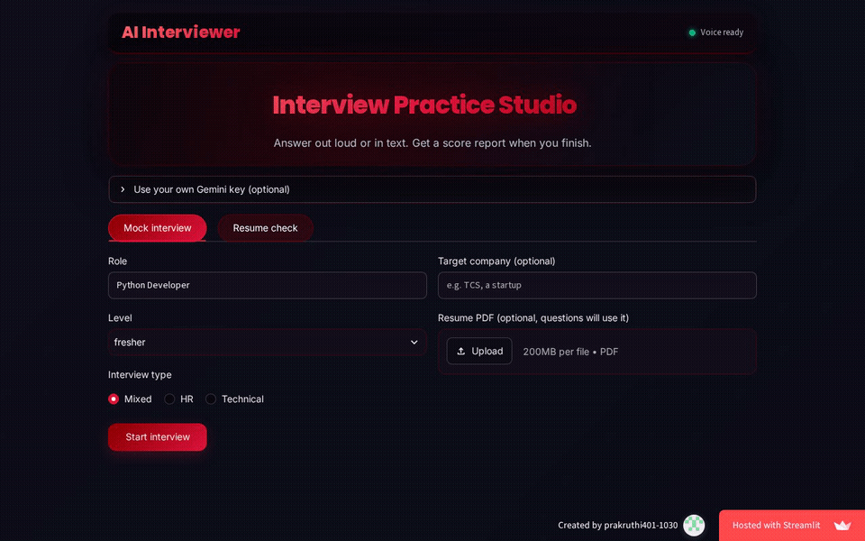

**Live app:** https://ai-interviewer-prakruthi.streamlit.app

# AI Interviewer

A Streamlit app for practising interviews. It has two parts.

**Mock interview.** Pick a role, level and interview type (HR, technical or mixed). Add a company name or your resume PDF if you want. The interviewer speaks each question out loud and an orb on screen pulses with the voice. Tap the mic to answer by voice (the orb turns green while it listens), or type. The interviewer asks one question at a time, asks follow-ups when your answer is vague, and after six answers gives a report with an overall score, four sub-scores, strengths, things to work on and a tip per question.

**Resume check.** Upload your resume and paste a job description. The app lists which skills the job asks for, which ones your resume has and which are missing, and shows a match percentage. This part is plain keyword matching in `resume_check.py`, not AI. There is an optional button that asks the model for tailoring tips.

## How it works

- Next question: `interviewer_prompt` in `app.py` sends the role, level, company style, resume text and the conversation so far to Gemini. There is no question bank.
- Report: `report_prompt` sends the whole transcript at the end and asks for JSON scores. If the reply is not valid JSON the app shows the raw text instead of crashing.
- Resume check: `find_skills` looks for about 50 skill words using word boundaries (so "java" does not match "javascript"). The match score is matched skills divided by skills in the job description.
- Voice lives in `voice.py`. Speaking uses the browser's `speechSynthesis`, listening uses the browser's speech recognition, and the orb is plain CSS animation that gets a small bump on every spoken word. The recognised text is put into the chat box and submitted.
- Chat history is kept in `st.session_state`.

## Run it

```
pip install -r requirements.txt
export GEMINI_API_KEY=your_key_here
streamlit run app.py
```

Get a free key from Google AI Studio. Anyone using the app can also paste their own key into the "Use your own Gemini key" box. It is used instead of the default key for that browser session only and is not stored. On Streamlit Cloud add it under Secrets as `GEMINI_API_KEY = "..."`. Never commit the key.

## Limits

- Voice works in Chrome and Edge (desktop and Android). Speech recognition is not available in every browser, then you type. No live video, and it is turn based rather than a free-flowing call.
- The company field only sets a general style. It does not use that company's real questions.
- Scores come from the model, so treat them as rough guidance.
- Resume reading needs a text-based PDF, scanned images will not work.
- The model names are a list at the top of `app.py`. If one is busy or retired, the next one is tried. The free key has a small daily limit.

## Demo



Live setup and a generated first question. This GIF has no audio; voice output and microphone support depend on your browser.
